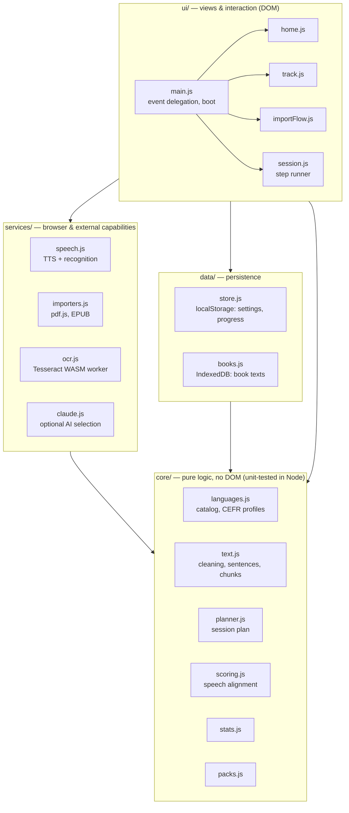

# Hopopo — Architecture

Hopopo is a client-only Progressive Web App for daily *shadowing* practice (listen to a sentence, then speak it along with the audio) in any of 21 languages, using the learner's own textbook as material.

## 1. Constraints that shaped the design

| Constraint | Consequence |
|---|---|
| Used on a phone, often on the go | PWA: installable, works offline, wake-lock during sessions, mobile-first UI |
| Free to host, nothing to operate | **No backend.** Static files on GitHub Pages; all processing on the device |
| The learner's books are private | Book text never leaves the device (except the optional Claude step, see §5.3) |
| Scanned textbooks, phone photos | On-device OCR (Tesseract compiled to WebAssembly, in a Web Worker) |
| Must also run inside a sandboxed iframe (Claude artifact viewer) | Every browser capability is feature-detected and degrades gracefully |
| Any language, not just EN/DE | Language behaviour is data (a catalog), not code branches |

## 2. Layers



**Dependency rule:** arrows point inwards only. `core/` imports nothing from the other layers and never touches `window`/`document`, which is why it runs unchanged under `node --test`. The UI is the only layer that knows about the DOM.

## 3. Module map

| Module | Responsibility |
|---|---|
| `core/languages.js` | Catalog of 21 languages (TTS tag, OCR code, speaking rate, RTL / no-space scripts), CEFR learning profiles A1–C1, sample texts |
| `core/text.js` | Raw text → paragraphs → sentences (`Intl.Segmenter`) → level-sized chunks; offline lesson filter (`heuristicPick`) |
| `core/planner.js` | Builds a session plan that fits the time budget; chunk navigation helpers |
| `core/scoring.js` | Aligns what was heard to the target (edit-distance DP) → per-word marks + score |
| `core/stats.js`, `core/packs.js` | Streaks/week view; shareable lesson format |
| `data/store.js` | App state in `localStorage` with schema migration |
| `data/books.js` | Book sentences in IndexedDB, in-memory cache, append/import/delete |
| `services/*` | Thin adapters over Web Speech, pdf.js, JSZip, Tesseract, Claude |
| `i18n.js` | Interface language (EN/FA), RTL switch, localized numbers |
| `ui/*` | Screens; each exports an `actions` map |
| `sw.js` | Service worker (offline) |

## 4. Data model

```text
localStorage["shadowing.v1"] = {
  ui: "en" | "fa",
  order: ["en", "de", "nl"],                       // track order on the home screen
  tracks: {
    nl: { lang, level: "A1", minutes, speed, voiceURI, warmup, check, checkReps,
          bookId,                                  // active book
          books: { <id>: { title, pos, total, last: [start, end] } },
          history: [{ d: "2026-11-22", sec, n }] }
  }
}
IndexedDB "shadowing" / store "books":  "book:<id>" → { id, lang, title, sentences: string[] }
```

Why two stores: progress and settings are small and read synchronously at startup (`localStorage`). Book texts can be megabytes and would hit the ~5 MB `localStorage` quota, so they go to IndexedDB, loaded on demand and cached in memory.

`pos` is a **sentence index**, not a chunk index. Chunking depends on the level, so storing sentence positions means changing level never corrupts progress.

## 5. Key flows

### 5.1 Planning a session (`core/planner.js`)

1. **Warm-up:** the last two sentences of the previous session, shadowed once.
2. **New material:** starting at `pos`, take *whole sentences* greedily. For each sentence, estimate the cost of every phase from word count ÷ speaking rate (plus the learner's turn for echo/check phases) and stop when the next sentence would exceed the budget (10–20 min).
3. **Final pass:** all new chunks shadowed back to back.

The plan is a flat list of steps `{k: chunkIndex, sec: 'review'|'main'|'final', ph: {t, r}}`. A flat list makes the player trivial: "next chunk", "previous chunk" and "replay" are index arithmetic, and progress is just "which step am I on".

Phases come from the CEFR profile: A1 gets ~8-word chunks at 0.7–0.85× speed with repeat-after-me steps; B2 gets ~22-word chunks at natural speed with a final "blind" pass (text hidden).

### 5.2 The session runner (`ui/session.js`)

The runner is an async loop over the steps: speak → (listen and score | silent gap) → next. Pause, skip and replay can happen at any time, during speech or while listening. These are handled with a **cancellation token**: every control action increments `R.token`, and each awaited operation checks `token === myToken` when it resumes. A stale loop simply returns. This avoids a tangle of `AbortController`s and timers and makes restarting from any step a single call: `runFrom(i)`.

Progress is committed per sentence while running, so leaving mid-session loses at most one sentence.

### 5.3 Importing a lesson (`ui/importFlow.js`): a fallback chain

```text
photos / scanned PDF ──► [inside Claude?] ──yes──► Claude reads the page images ──► selection
                               │no
                               ▼
                       on-device OCR (Tesseract) ──► text ──► [inside Claude?] ──yes──► Claude selection
                                                                   │no
text PDF / EPUB / TXT / paste ──────────────────────────────────►  ▼
                                                        offline heuristic (core/text.js)
                                                                   ▼
                                               review screen (learner ticks/unticks) ──► book
```

Every stage has a fallback, so the feature works with zero network and zero AI, and simply gets better when more is available. The AI step is an *enhancement*, not a dependency. The learner always reviews the selection before it is saved: OCR and AI output are never trusted blindly.

The heuristic drops lines that start with task verbs in several languages ("Hören Sie…", "Complete…", "Luister…"), gap-fills (`____`), numbering, speaker labels, word lists and number-heavy lines, then keeps paragraphs that end in sentence punctuation.

### 5.4 Speech check (`core/scoring.js`)

Recognition comes from the Web Speech API in the learner's language. Scoring aligns heard tokens to target tokens with an edit-distance DP. Substitution cost depends on fuzzy word similarity (Levenshtein ratio, with accent-only differences at 0.9), and insertions cost less than deletions, so filler words ("eh…") barely matter while skipped words do. Backtracking gives a mark per target word: **ok / close / bad**. Digits are folded to number words for en/de/nl, because recognizers often return "7" for "sieben". Scripts without spaces (Japanese, Chinese) are compared per character.

### 5.5 Offline (`sw.js`)

* **App shell** (HTML, CSS, JS modules, icons): pre-cached on install, then served **network-first** so a new deploy reaches users immediately, with the cache as the offline fallback.
* **Heavy assets** (OCR engine ~4 MB, language data, pdf.js, fonts): **cache-first**, cached the first time they're used.
* OCR data for German/English ships inside the app (so it works offline and inside sandboxes that block downloads). The other 19 languages download once from jsDelivr through a small wrapper around the worker's `fetch`, so adding a language needs no rebuild.

### 5.6 Internationalisation

Two independent axes:

* **Interface language** (EN/FA): `tt(en, fa)` keeps both strings next to the code that uses them, which is practical for two languages. `setUI` flips `dir="rtl"`, and the CSS uses logical properties (`text-align:start`, `inline-end`).
* **Learning language** (21): pure data in the catalog. RTL learning languages (Arabic, Persian) get `dir="rtl"` on the text card independently of the interface direction.

## 6. Decisions and trade-offs

| Decision | Why | Cost / what I'd revisit |
|---|---|---|
| **No framework, no build step** (native ES modules) | Tiny app, deploys as static files, opens instantly on phones, no toolchain to maintain; modules give the structure a framework would | Manual DOM updates. At ~3–4× this size I'd move to a small component library (Preact/Lit) and TypeScript |
| **No backend** | Zero cost, zero ops, privacy by default | No cross-device sync; sharing is done with explicit "packs" |
| **Browser TTS** (Web Speech) instead of cloud TTS | Free, offline, no API keys, ~all languages | Voice quality varies by device; mitigated by preferring "Enhanced/Neural" voices and letting the user choose |
| **On-device OCR** (Tesseract WASM) | Works offline, nothing uploaded | Slower than cloud OCR (seconds per page); mitigated with page ranges, incremental "append to book", cancellation |
| **AI as optional enhancement** | Best selection quality when available, app still fully functional without it | Two code paths to test |
| **Sentence-level progress** | Stable across level changes and re-chunking | Resuming can repeat up to one sentence |
| **Event delegation + `actions` maps** | One listener per event type; views re-render with `innerHTML` without leaking listeners | Action names are a flat namespace (prefixed by convention) |
| **Cancellation token** in the runner | Simple, correct pause/skip semantics for async speech | Each await point must check the token |
| **localStorage + IndexedDB** | Fast startup plus large book storage | Storage can be evicted by the browser; packs double as backups |

## 7. Testing

* **Unit tests:** `node --test` (no dependencies), 23 tests covering the pure core: text cleaning, sentence/chunk splitting (incl. Dutch conjunctions and Japanese), planning within budgets, warm-up/resume, alignment scoring, streaks, pack validation.
* **End-to-end:** Playwright scripts drive the real UI in Chromium with mocked speech APIs and a mocked Claude: add a language → run a Dutch session with speech check → import a pasted lesson, photos (real OCR) and a scanned PDF → export a pack and import it on a "fresh device" → remove a language → switch to RTL.

Run unit tests with `npm test`.

## 8. Known limitations and next steps

1. **Pronunciation:** the check verifies *words*, not phonemes. Next: phoneme-level scoring (e.g. forced alignment with a small on-device model).
2. **Spaced repetition:** sentences scored < 70% could be re-queued in later sessions (an SM-2-style schedule).
3. **Sync:** optional encrypted sync (e.g. to the user's own cloud drive) instead of a backend.
4. **CI:** GitHub Actions running `npm test` + Playwright on each push; Lighthouse PWA/accessibility budget.
5. **Types:** JSDoc types are partial; migrate `core/` to TypeScript first (it has no DOM dependencies, so it's the cheapest place to start).
6. **Recognition:** Web Speech recognition availability differs by browser (e.g. iOS needs Siri/Dictation enabled); a WASM speech model would remove that dependency at the cost of download size.
